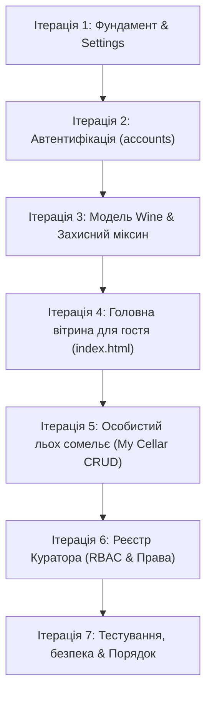

# ROADMAP: WINE VAULT (Iтерацiї Розробки)
## Покроковий Iнженерний План Побудови Проєкту на CBV та Автентифiкацiї

---

---

### Iтерацiя 1: Фундамент, Застосунки та Конфiгурацiя (`config/`)
- [x] **Статус:** ВИКОНАНО.
* **Мета:** Створити чистий проєкт Django з двома iзольованими доменами (`accounts` та `wines`), налаштувати статику та глобальнi параметри.
* **Що зроблено:**
  1. Iнiцiалiзацiя структури через `uv init` / `django-admin startproject config .`.
  2. Застосунки `accounts` та `wines`.
  3. `config/settings.py` налаштовано (STATIC, TEMPLATES, редиректи, сувора типізацiя).
  4. Справжнiй бiнарний мультироздiльний `static/img/favicon.ico`.

---

### Iтерацiя 2: Автентифiкацiя та Шаблони Входу/Реєстрацiї (`accounts/`)
- [x] **Статус:** ВИКОНАНО.
* **Мета:** Повноцiнний вхiд, вихiд та реєстрацiя виноробiв iз фiрмовим дизайном старовинного винного льоху (без iнлайн-стилiв, у pure px).
* **Що зроблено:**
  1. `accounts/urls.py` та `accounts/views.py` (LoginView, LogoutView, SignUpView).
  2. Базовий каркас `templates/base.html` з янтарною палiтрою, шапкою та футером.
  3. `templates/registration/login.html` та `signup.html`.

---

### Iтерацiя 3: Доменна Модель `Wine` та Центральний Захисний Мiксин
- [x] **Статус:** ВИКОНАНО.
* **Мета:** Задати структуру пляшки вина, зв'язок з автором-сомельє та створити залiзобетонний мiксин безпеки об'єктiв.
* **Що зроблено:**
  1. `wines/models.py` (модель Wine з полями, оцiнкою, цiною, сомельє та правом `view_all_wines`).
  2. `wines/mixins.py` (OwnedWineMixin, що iзолює вибiрку до `sommelier=request.user`).
  3. Мiграцiї застосовано.

---

### Iтерацiя 4: Головна Вiтрина для Гостя (`index.html`)
- [x] **Статус:** ВИКОНАНО.
* **Мета:** Створити повноцiнну головну сторiнку маркетплейсу, де будь-який гiсть (без логiну) бачить атмосферний банер, iсторiю та вiтрину ВСIХ авторських вин для замовлення/купiвлi.
* **Що зроблено:**
  1. `MarketplaceIndexView(generic.ListView)` у `wines/views.py` (публiчний доступ, всi вина з бази).
  2. Маршрут `/` у `wines/urls.py` веде саме на головну вiтрину, усунено дублiкати.
  3. Створено та наповнено `templates/index.html` в автентичному дусi виноробiв (Hero, фiлософiя теруару, картки вин, пагiнацiя).

---

### Iтерацiя 5: Особистий Льох Сомельє (`/cellar/`) та CBV CRUD
- [ ] **Статус:** ОЧIКУЄ.
* **Мета:** Особистий кабiнет майстра-винороба для ведення власного врожаю.
* **Кроки:**
  1. Маршрут `/cellar/` (`MyCellarView` або `WineListView`) захищений `OwnedWineMixin`.
  2. Додавання (`/cellar/add/`), редагування (`/cellar/<pk>/edit/`), списання (`/cellar/<pk>/delete/`).
  3. Картка вина `wine_detail.html` (розумний показ кнопок редагування лише автору).

---

### Iтерацiя 6: Реєстр Куратора (RBAC) та Адмiн-панель
- [ ] **Статус:** ОЧIКУЄ.
* **Мета:** Спецiальний доступ для Головного сомельє (`wines.view_all_wines`) та суперкористувача.
* **Кроки:**
  1. `CellarOverviewView` за адресою `/overview/` (лише для користувачiв з правом `view_all_wines`).
  2. Пункт у меню `base.html` з'являється тiльки у кураторiв.
  3. Реєстрацiя в Django Admin (`wines/admin.py`).

---

### Iтерацiя 7: Аудит Безпеки, Порядок у Проєктi та Тестування
- [ ] **Статус:** ОЧIКУЄ.
* **Мета:** Повний порядок у файлах, документацiї, лiнтерах та 100% проходження тестiв.
* **Кроки:**
  1. Автоматизованi тести `wines/tests.py` та `accounts/tests.py`.
  2. Лiнтер Ruff (0 помилок), суворий Pylance (0 помилок).
  3. Вiдсутнiсть зайвих файлiв, повна вiдповiднiсть вимогам ДЗ-23.
