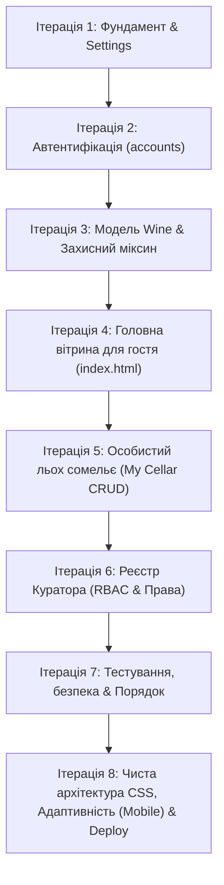

# ROADMAP: WINE VAULT (Iтерацiї Розробки)
## Покроковий Iнженерний План Побудови Проєкту на CBV, Автентифiкацiї та Адаптивному Дизайнi

---

---

### Архітектурні Принципи Проєкту
1. **Чисті класи без спадкової вкладеності (No Tag Cascades):** Кожен HTML-тег має свій явний семантичний клас. CSS звертається виключно до селекторів класів (жодної вкладеності на кшталт `div -> div -> h3 -> span` чи `.card h3`).
2. **Сувора заборона `rem`:** 100% розмірів та відступів реалізовано виключно у `px`.
3. **Жодних інлайн-стилів:** Повна ізоляція стилізації у `static/css/vault.css`.
4. **Повна адаптивність (Mobile First / Responsive):** Інтерактивне бургер-меню з анімацією перетворення в хрестик, вертикальне стекування карток на смартфонах, горизонтальний скрол для зведених таблиць, центровані мобільні форми без переливання за межі екрана.
5. **Сувора безпека та типізація:** 10 автоматизованих тестів безпеки (RBAC, IDOR-захист, ізоляція даних), 0 помилок Ruff та суворого Pylance.

---

### Iтерацiя 1: Фундамент, Застосунки та Конфiгурацiя (`config/`)
- [x] **Статус:** ВИКОНАНО.
* **Мета:** Створити чистий проєкт Django з двома iзольованими доменами (`accounts` та `wines`), налаштувати статику та глобальнi параметри.
* **Що зроблено:**
  1. Iнiцiалiзацiя структури через `uv init` / `django-admin startproject config .`.
  2. Застосунки `accounts` та `wines`.
  3. `config/settings.py` налаштовано (STATIC, TEMPLATES, редиректи, сувора типізацiя).
  4. Справжнiй бiнарний мультироздiльний `static/img/favicon.ico`.

---

### Iтерацiя 2: Автентифiкацiя та Шаблони Входу/Реєстрацiї (`accounts/`)
- [x] **Статус:** ВИКОНАНО.
* **Мета:** Повноцiнний вхiд, вихiд та реєстрацiя виноробiв iз фiрмовим дизайном старовинного винного льоху (без iнлайн-стилiв, у pure px).
* **Що зроблено:**
  1. `accounts/urls.py`, `accounts/views.py` та `accounts/forms.py` (LoginView, LogoutView, SignUpView зі стилізованими віджетами).
  2. Базовий каркас `templates/base.html` з янтарною палiтрою, шапкою та футером.
  3. `templates/registration/login.html` та `signup.html` з явними класами для кожного тегу.

---

### Iтерацiя 3: Доменна Модель `Wine` та Центральний Захисний Мiксин
- [x] **Статус:** ВИКОНАНО.
* **Мета:** Задати структуру пляшки вина, зв'язок з автором-сомельє та створити залiзобетонний мiксин безпеки об'єктiв.
* **Що зроблено:**
  1. `wines/models.py` (модель Wine з полями, оцiнкою, цiною, сомельє та правом `view_all_wines`).
  2. `wines/mixins.py` (OwnedWineMixin, що iзолює вибiрку до `sommelier=request.user`).
  3. Мiграцiї застосовано.

---

### Iтерацiя 4: Головна Вiтрина для Гостя (`index.html`)
- [x] **Статус:** ВИКОНАНО.
* **Мета:** Створити повноцiнну головну сторiнку маркетплейсу, де будь-який гiсть (без логiну) бачить атмосферний банер, iсторiю та вiтрину ВСIХ авторських вин для замовлення/купiвлi.
* **Що зроблено:**
  1. `MarketplaceIndexView(generic.ListView)` у `wines/views.py` (публiчний доступ, всi вина з бази).
  2. Маршрут `/` у `wines/urls.py` веде саме на головну вiтрину.
  3. `templates/index.html` (Hero-банер, цінності теруару, адаптивна сітка карток, пагінація).

---

### Iтерацiя 5: Особистий Льох Сомельє (`/cellar/`) та CBV CRUD
- [x] **Статус:** ВИКОНАНО.
* **Мета:** Особистий кабiнет майстра-винороба для ведення власного врожаю.
* **Що зроблено:**
  1. Маршрут `/cellar/` (`WineListView`) захищений `OwnedWineMixin`.
  2. Додавання (`/cellar/new/`), редагування (`/cellar/<pk>/edit/`), списання (`/cellar/<pk>/delete/`) через форму `WineForm`.
  3. Картка вина `wine_detail.html` (розумний показ кнопок редагування лише автору).

---

### Iтерацiя 6: Реєстр Куратора (RBAC) та Адмiн-панель
- [x] **Статус:** ВИКОНАНО.
* **Мета:** Спецiальний доступ для Головного сомельє (`wines.view_all_wines`) та суперкористувача.
* **Що зроблено:**
  1. `CellarOverviewView` за адресою `/overview/` (захищений `PermissionRequiredMixin`).
  2. Пункт у меню `base.html` з'являється тiльки у кураторiв (`perms.wines.view_all_wines`).
  3. Реєстрацiя в Django Admin (`wines/admin.py`), призначення прав групі «Головні сомельє».

---

### Iтерацiя 7: Тестування та Безпека
- [x] **Статус:** ВИКОНАНО.
* **Мета:** Повний автоматизований контроль безпеки та відсутності регресій.
* **Що зроблено:**
  1. 10/10 автоматизованих тестів (`wines/tests.py`, `accounts/tests.py`) пройдено успішно.
  2. Перевірка IDOR-атак (спроби підміни URL повертають 404).
  3. Перевірка доступу до звіту куратора (неавторизовані сомельє отримують 403 Forbidden).

---

### Iтерацiя 8: Адаптивний Дизайн (Mobile/Tablet) та Підготовка до Railway
- [x] **Статус:** ВИКОНАНО.
* **Мета:** Забезпечити 100% якісну адаптивність на смартфонах/планшетах та підготувати проєкт до хмарного розгортання.
* **Що зроблено:**
  1. Усі HTML-теги отримали індивідуальні семантичні класи.
  2. CSS повністю очищено від вкладених селекторів тегів (`div -> div -> h3 -> span`).
  3. Інтерактивне бургер-меню (`vault-burger-btn` + `static/js/vault.js`) з плавною анімацією відкриття/закриття на екранах <= 860px.
  4. Адаптивні медіа-запити для смартфонів (<= 480px) та планшетів (<= 860px) виключно у `px`.
  5. Продакшен-конфігурація: `gunicorn`, `whitenoise`, `psycopg`, `dj-database-url`, `Procfile`, `requirements.txt`.
