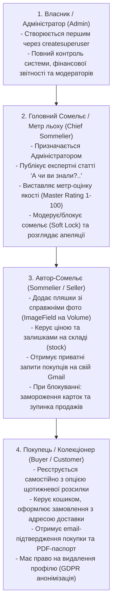

# 📜 SPECS: Wine Vault — Елітний маркетплейс авторських вин та винний клуб
> **Технічна специфікація фінального проєкту (Final-DZ_24)**  
> **Статус:** Комерційний стандарт (чистий проєкт для здачі замовнику)  
> **Стек:** Python 3.12+, Django 5.2/6.1, DRF, ReportLab Platypus, uv, Ruff, PostgreSQL (Railway) + Railway Volume.  
> **Поштовий транспорт:** Реальний Gmail SMTP (`smtp.gmail.com`).

---

## 1. Загальний опис проєкту та комерційні вимоги

**«Wine Vault»** — це повнофункціональний маркетплейс крафтових вин та закритий клуб сомельє. Проєкт створюється за суворими комерційними стандартами:
1. **Абсолютно чистий старт (Zero Hardcoded Data):**  
   * Жодних захардкодженних користувачів (`Simon`, `Pierre`, `Aleks`), мокових паролів чи фіктивних описів у коді `.py` та міграціях.
   * Жодних статичних випадаючих списків зображень (`IMAGE_CHOICES`).
   * База даних стартує чистою; перший адміністратор створюється власником через `createsuperuser`. Усі вина, автори та описи додаються виключно динамічно через вебінтерфейс.
2. **Безпечні ідентифікатори (Public-ID / `slug-uuid`):**  
   * Жодних відкритих цілочислових ID (`/wines/1/`). Посилання на товари мають вигляд: `/wines/<slug>-<uuid:short>/` (наприклад, `/wines/chateau-noir-reserve-2014-a1b2c3d4/`). Захист від IDOR/скрейпінгу та максимальне SEO.
3. **Сувора валідація на всіх рівнях:**  
   * Усі форми та поля моделей валідуються як у базі даних (`CheckConstraint`), так і в Django-валідаторах (`rating` 1–100, `price > 0`, `1900 <= year <= поточний рік`, формати файлів, розмір зображень до 5 МБ).
4. **Хмарне медіасховище (Railway Volume):**  
   * Справжнє завантаження фотографій з телефону/ПК через `models.ImageField(upload_to="wines/%Y/%m/")`.
   * Збереження на постійний диск Railway Volume (`/app/media`), що не втрачає файли під час повторних деплоїв.
5. **Реальний поштовий сервер (Gmail SMTP):**  
   * Жодних моків: відправка чеків покупцям, зв'язок «Покупець ➔ Сомельє» та апеляції до Метра через захищений TLS-канал Gmail SMTP.
6. **Повноцінний цикл E-Commerce для покупця:**  
   * Реєстрація з чекбоксом маркетингової розсилки.
   * Кошик із гнучким керуванням кількістю.
   * Оформлення замовлення з адресою, способом доставки (Нова Пошта / кур'єр / самовивіз) та трекінгом статусів.
   * Захист від заблокованих сомельє: автоблокування покупки товарів у кошику.
   * Видалення акаунта за стандартом GDPR (анонімізація з безпечним збереженням фінансової історії для адміна).

---

## 2. Модель акторів та ієрархія ролей (RBAC)



---

## 3. Специфікація моделей даних (Чиста архітектура)

### 3.1. Користувачі та Профілі (`accounts`)
* **`User` (розширений або зв'язаний з `UserProfile`):**
  * `role`: `buyer`, `sommelier`, `chief`, `admin` (дефолт `buyer`).
  * `is_subscribed`: `BooleanField(default=False)` — чекбокс згоди на щотижневі розсилки при реєстрації.
  * `phone`: `CharField(max_length=20, blank=True)` — валідований телефон для доставки.
  * `tokens_valid_from`: `DateTimeField(null=True)` — відсічка JWT-сесій.
* **`SommelierProfile` (створюється тільки для сомельє):**
  * `user`: `OneToOneField(User, on_delete=models.CASCADE)`.
  * `winery_name`: Назва шато/виноробні.
  * `bio`: Досвід та опис теруару.
  * `contact_email`: Email для сповіщень від покупців (дефолт `user.email`).
  * `is_suspended`: `BooleanField(default=False)` — прапорець модерації.
  * `suspension_reason`: Причина блокування Метром.

### 3.2. Вина та Склад (`wines.Wine`)
* **Ідентифікатори:**
  * `public_id`: `UUIDField(default=uuid.uuid4, unique=True, editable=False)` — публічний токен.
  * `slug`: `SlugField(max_length=255, unique=True)` — формується як `title-year-shortuuid`.
* **Поля та валідатори:**
  * `title`: Назва (макс 200 символів, обов'язкове).
  * `winery`: Виноробня (макс 150 символів).
  * `region`: Регіон походження.
  * `year`: `PositiveIntegerField` + валідатори `MinValueValidator(1900)`, `MaxValueValidator(поточний_рік)`.
  * `wine_type`: `red`, `white`, `rose`, `sparkling`, `dessert`.
  * `grape`: Сорт винограду.
  * `price`: `DecimalField(max_digits=10, decimal_places=2)` + `MinValueValidator(Decimal("0.01"))`.
  * `stock`: `PositiveIntegerField(default=1)` + `MinValueValidator(0)` (залишок на складі).
  * `rating`: `PositiveSmallIntegerField(default=90)` + валідатори `MinValueValidator(1)`, `MaxValueValidator(100)`.
  * `master_rating`: `PositiveSmallIntegerField(null=True, blank=True)` + `1..100`.
  * `tasting_notes`: Опис смаку, аромату, післясмаку.
  * `image`: `ImageField(upload_to="wines/%Y/%m/")` — збереження на Railway Volume. Валідація: тільки JPG, PNG, WEBP, розмір до 5 МБ.
  * `sommelier`: `ForeignKey(User, on_delete=models.CASCADE)`.
  * `is_active`: `BooleanField(default=True)`.
* **Обмеження рівня СУБД (`CheckConstraint`):**
  * `price > 0`
  * `stock >= 0`
  * `rating BETWEEN 1 AND 100`

### 3.3. Кошик, Замовлення та Доставка (`orders`)
* **`Cart` & `CartItem`:**
  * Кошик прив'язаний до сесії або до `User`.
  * При відкритті кошика виконується перевірка: якщо `wine.sommelier.sommelier_profile.is_suspended == True`, товар позначається як «Недоступний», кнопка покупки вимикається, сума позиції не враховується.
* **`Order`:**
  * `public_id`: `UUIDField(default=uuid.uuid4, unique=True)`.
  * `user`: `ForeignKey(User, on_delete=models.SET_NULL, null=True)` (щоб історія замовлення жила навіть після видалення профілю покупця).
  * `buyer_name`, `buyer_email`, `buyer_phone`: знімок контактів на момент замовлення.
  * **Доставка:**
    * `delivery_method`: `nova_poshta_branch` (Відділення НП), `nova_poshta_locker` (Поштомат), `courier` (Кур'єр), `pickup` (Самовивіз із бутіка).
    * `city`: Місто доставки.
    * `destination`: Номер відділення/поштомату або повна адреса.
    * `tracking_number`: `CharField(blank=True)` — номер ТТН для відстеження.
    * `status`: `pending` (Нове), `processing` (Збирається сомельє), `shipped` (Передано в доставку), `delivered` (Доставлено), `canceled` (Скасовано).
  * `total_price`: Загальна сума замовлення.
  * `created_at`: Час створення.
* **`OrderItem`:**
  * Фіксує назву вина, ціну за одиницю та кількість на момент покупки.
  * Атомарне списання зі складу при оформленні через вираз Django `F("stock") - quantity`.

### 3.4. Комунікація покупця з сомельє (`wines.WineInquiry`)
* Покупець на сторінці пляшки натискає *"Запитати автора-сомельє"*.
* Модель або форма з полями: `wine`, `buyer_name`, `buyer_email`, `question_text`.
* Через **Gmail SMTP** лист миттєво доставляється на контактний email відповідного сомельє з темою: *«[Wine Vault] Питання щодо пляшки {wine.title}»*.

---

## 4. Інфраструктура та Медіа на Railway

* **Диск Railway Volume:**
  * Точка монтування: `/app/media`.
  * Налаштування Django:
    ```python
    MEDIA_URL = "/media/"
    MEDIA_ROOT = os.getenv("MEDIA_ROOT", BASE_DIR / "media")
    ```
* **Роздача медіафайлів:**
  * Локально: через `django.conf.urls.static.static`.
  * На продакшні: WhiteNoise або сервірування через Django View/Nginx.

---

## 5. Поштова підсистема (Gmail SMTP)

Конфігурація у `settings.py` (зі змінними з `.env`):
```python
EMAIL_BACKEND = "django.core.mail.backends.smtp.EmailBackend"
EMAIL_HOST = "smtp.gmail.com"
EMAIL_PORT = 587
EMAIL_USE_TLS = True
EMAIL_HOST_USER = os.getenv("EMAIL_HOST_USER")          # Ваш робочий Gmail
EMAIL_HOST_PASSWORD = os.getenv("EMAIL_HOST_PASSWORD")  # 16-значний Google App Password
DEFAULT_FROM_EMAIL = f"Wine Vault <{os.getenv('EMAIL_HOST_USER')}>"
```
**Сценарії відправки листів:**
1. Покупцю: підтвердження замовлення з деталями доставки + вкладений PDF-паспорт вина.
2. Сомельє: сповіщення про нове замовлення його пляшки або повідомлення від покупця.
3. Головному Сомельє: сповіщення про нове звернення/апеляцію від сомельє.

---

## 6. Безпека, Конфіденційність (GDPR) та Видалення акаунта

* **Видалення профілю покупцем:**
  * Кнопка в особистому кабінеті покупця: *«Видалити мій профіль»*.
  * Модальне вікно попередження про незворотність дії.
  * **Логіка обробки:**
    * Акаунт покупця деактивується (`is_active = False`).
    * Персональні дані анонімізуються (`username = f"deleted_{uuid}"`, `email = f"anonymized_{uuid}@vault.local"`, пароль стирається).
    * `Order.user` залишається збереженим або стає `SET_NULL`, що зберігає комерційну звітність магазину без порушення права клієнта на забуття.
