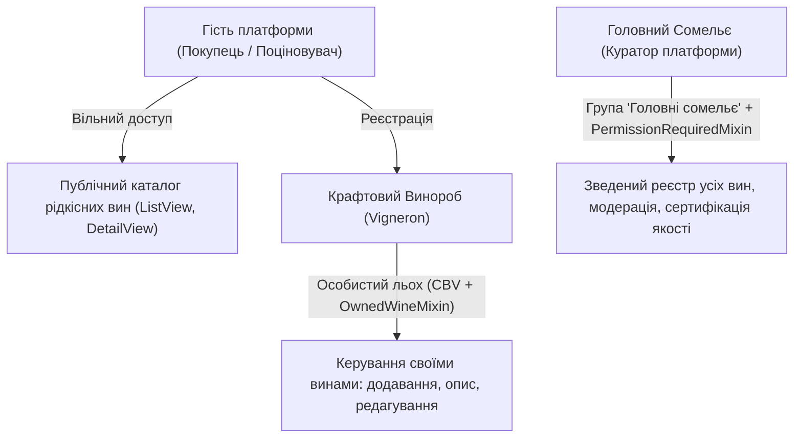

# WINE VAULT — Глобальний Маркетплейс Авторських Вин
## Маніфест Проєкту, Філософія Дизайну та Архітектурна Місія

---

## 1. Візія та Місія Проєкту

**WINE VAULT** — це цифровий портал у світ автентичного, крафтового виноробства. Це глобальна платформа для незалежних винарів, сімейних шато та професійних сомельє, де кожна пляшка — це не просто товар мас-маркету, а витвір мистецтва з власною історією, теруаром і характером.

> **Місія:** З'єднати поціновувачів рідкісних вин безпосередньо з крафтовими виноробами без посередників, надавши кожному майстру вина свій персональний цифровий льох для презентації врожаїв, дегустаційних карт та управління продажами.

---

## 2. Атмосфера та Філософія Дизайну («Притемнене Оранжування»)

Візуальний стиль проєкту відтворює відчуття **глибокого старовинного винного льоху (Cave a Vin)**:
* Запах дубових бочок, прохолодний темний вапняковий камінь, тиша підземелля.
* М'яке, тепле бурштиново-помаранчеве світло свічок та гасових ламп, яке грає відблисками на склі темних пляшок.
* Акценти глибокого рубінового таніну та теплого коньячного дерева.

### Фірмова Колірна Палітра (Dark Amber Cellar Palette):

| Елемент | HEX-код | Образ / Відчуття |
| :--- | :--- | :--- |
| **Primary Background** | `#0a0908` | Темний камінь глибокого льоху, напівтемрява |
| **Card / Vault Surface** | `#1c1917` (rgba: `28, 25, 23, 0.9`) | Віковий морений дуб бочок, матовий оксамит |
| **Candle Amber (Accent)** | `#d97706` / `#f59e0b` | Теплий янтар, відблиск живого полум'я свічки |
| **Warm Cognac (Glow)** | `#b45309` / `#92400e` | Благородний коньячний відтінок, карамель |
| **Wine Tannin (Secondary)**| `#7f1d1d` / `#581c87` | Глибокий винний осад, бордо, чорний виноград |
| **Text Primary** | `#f5f5f4` | Старовинний пергамент, м'який кремовий колір |
| **Text Muted** | `#a8a29e` | Порох часу, делікатний кам'яний сірий |

> [!IMPORTANT]
> **Золоте правило стилізації:** Жодних інлайн-стилів (`style="..."`) в HTML-шаблонах. Усі стилі виносяться в семантичні та модульні CSS-файли у папку `static/css/`, а розміри задаються суворо в px без використання rem.

---

## 3. Технологічний Стек (Modern & Robust)

* **Backend Framework:** Python 3.11+ / Django 5.2+
* **Архітектура контролерів:** Суворо **Class-Based Views (CBV)**: `ListView`, `DetailView`, `CreateView`, `UpdateView`, `DeleteView`
* **Безпека та авторизація:** `django.contrib.auth`, кастомні міксини `OwnedWineMixin`, ролі через групи `Group`, перевірки `PermissionRequiredMixin`
* **Frontend:** Чистий семантичний HTML5 + сучасний модульний CSS3 (у px, без rem) + нативний JavaScript
* **База даних:** SQLite (для розробки) з повною готовністю до міграції на PostgreSQL у продакшні.

---

## 4. Рольова Модель та Рівні Доступу

1. **Гість (Покупець):**
   * Переглядає каталог авторських вин з фільтрами за роком врожаю, сортом винограду, країною/регіоном та міцністю.
   * Читає професійні дегустаційні нотатки автора.
2. **Автор / Крафтовий Винороб (Vigneron):**
   * Має персональний автентифікований доступ (`/accounts/login/`).
   * Бачить і керує **виключно своїми пляшками** завдяки залізобетонній ізоляції `OwnedWineMixin`.
   * Може додавати новий врожай через `WineCreateView` (авторство підставляється автоматично на сервері).
3. **Головний Сомельє (Куратор):**
   * Спеціальна роль у системі з кастомним правом `wines.view_all_wines`.
   * Доступ до зведеної аналітики, модерації вин та перевірки сертифікатів автентичності.

---

## 5. Чому цей проєкт ідеально закриває ДЗ-23

1. **Жодного слова «Task»:** Проєкт живий, комерційно правдоподібний і зрозумілий.
2. **Абсолютна чистота коду:** Тонкі в'юхи, правильне використання хуків `get_queryset`, `form_valid`, `get_success_url`.
3. **Захист від зламу на рівні архітектури:** Захист від підміни автора (Mass Assignment), захист від доступу до чужих пляшок (IDOR), безпечний вихід через POST та CSRF-токени.
